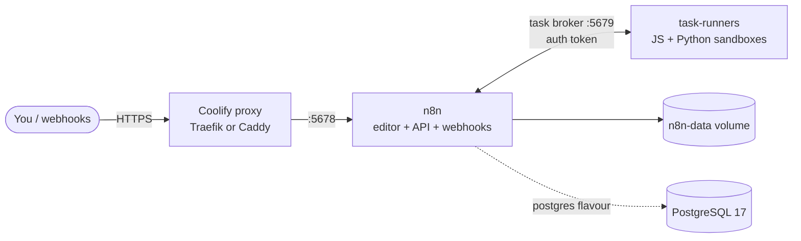

<div align="center">

# n8n on Coolify

**Run your own n8n on your own server in about two minutes.** It comes with HTTPS, isolated JavaScript and Python task runners, healthchecks and secure defaults.

[](https://hub.docker.com/r/n8nio/n8n/tags)
[](https://coolify.io)
[](docker-compose.yml)
[](LICENSE)

</div>

---

## Why this repo?

[n8n](https://n8n.io) is an open-source workflow automation tool, similar to Zapier or Make, that you can host yourself. [Coolify](https://coolify.io) is an open-source PaaS, similar to Heroku or Vercel, that runs on your own VPS. Together they give you unlimited workflows on hardware you control, with no per-execution fees.

The compose files here are ready to paste into Coolify:

- ✅ **n8n 3.x**, pinned to an exact version so updates never surprise you.
- ✅ **External task runners.** Your Code nodes (JavaScript **and** native Python) run in a separate, sandboxed container instead of inside the main n8n process.
- ✅ **No secrets to invent.** Coolify generates the domain, the HTTPS certificate and the runner auth token for you.
- ✅ **Healthchecks on every service**, so Coolify knows when the app is really up and starts the containers in the right order.
- ✅ **Secure defaults.** Code nodes can't read environment variables, the Git node blocks bare repos, settings file permissions are enforced, and n8n is set up to sit behind Coolify's reverse proxy.
- ✅ **Two flavours.** SQLite for simple setups, PostgreSQL for production.
- ✅ **No 3.x deprecation warnings** at startup.

## Pick your flavour

| File | Database | Best for |
|---|---|---|
| [`docker-compose.yml`](docker-compose.yml) | SQLite (inside the n8n volume) | Personal use, small teams, getting started |
| [`docker-compose.postgres.yml`](docker-compose.postgres.yml) | PostgreSQL 17 | Heavier workloads, many executions, easier backups and tooling |

> 💡 Not sure? Start with **SQLite**. It's one less container and is perfectly fine for most personal setups.

## Architecture



- Only **n8n** is exposed to the internet, through Coolify's proxy. The runners and the database stay on the private Docker network.
- When a workflow reaches a Code node, n8n sends the task to the **task-runners** container. The two sides authenticate with a shared token that Coolify generates (`SERVICE_PASSWORD_N8N`).

## Quick start (Coolify)

### Prerequisites

- A server with [Coolify v4](https://coolify.io/docs/get-started/installation) installed. Plan for **2 GB RAM or more**.
- (Optional) A domain or subdomain, such as `n8n.example.com`, with an **A record** pointing to your server's IP.

### Option A: paste the compose file (easiest)

1. In Coolify, open your **Project → Environment → + New → Docker Compose Empty**.
2. Paste the contents of [`docker-compose.yml`](docker-compose.yml) (or [`docker-compose.postgres.yml`](docker-compose.postgres.yml)) and save.
3. Open the **n8n** service settings and set its **Domain**, for example `https://n8n.example.com`.
   *If you skip this, Coolify generates a temporary `sslip.io` URL so you can try it right away.*
4. (Optional) Set your timezone in **Environment Variables**: `GENERIC_TIMEZONE=Europe/Lisbon` and `TZ=Europe/Lisbon`.
5. Click **Deploy**. Wait until all containers show **healthy** (about a minute on the first pull).
6. Open your domain and create your **owner account**. 🎉

### Option B: deploy straight from this repository

1. In Coolify, open **+ New → Public Repository** and enter `https://github.com/carlosribeirodev/coolify-n8n`.
2. Choose **Build Pack: Docker Compose**.
3. Set **Docker Compose Location** to `/docker-compose.yml` (or `/docker-compose.postgres.yml`).
4. Continue from step 3 of Option A.

> Tip: **fork** this repo first if you want to control exactly when your server picks up changes.

## How the Coolify "magic" variables work

Coolify reads special variable names in the compose file and fills them in for you:

| Variable | What Coolify does with it |
|---|---|
| `SERVICE_URL_N8N_5678` | Creates a public URL for the `n8n` service and routes it to port `5678` |
| `SERVICE_URL_N8N` | The full URL, e.g. `https://n8n.example.com`. Used for the editor and webhook URLs |
| `SERVICE_FQDN_N8N` | The host name only, e.g. `n8n.example.com` |
| `SERVICE_PASSWORD_N8N` | A random secret, used as the runner ↔ broker auth token |
| `SERVICE_USER_POSTGRES` / `SERVICE_PASSWORD_POSTGRES` | Random database credentials (Postgres flavour only) |

You never have to type these yourself. See the [Coolify docs](https://coolify.io/docs/knowledge-base/docker/compose#coolifys-magic-environment-variables) for details.

## Configuration

Every setting below has a sensible default. Override any of them under **Environment Variables** in Coolify.

### n8n

| Variable | Default | Description |
|---|---|---|
| `GENERIC_TIMEZONE` | `UTC` | Timezone for Schedule/Cron nodes |
| `TZ` | `UTC` | Container system timezone (keep it the same as above) |
| `N8N_PROTOCOL` | `https` | Protocol n8n uses to build its own URLs |
| `N8N_LISTEN_ADDRESS` | `0.0.0.0` | Interface n8n listens on. IPv4 works everywhere, including hosts with IPv6 disabled |
| `N8N_PROXY_HOPS` | `1` | Number of reverse proxies in front of n8n (Coolify's proxy = 1). Set to `2` if you also use Cloudflare proxying |
| `DB_SQLITE_POOL_SIZE` | `2` | SQLite read connection pool (SQLite flavour only) |
| `POSTGRES_DB` | `n8n` | Database name (Postgres flavour only) |

### Task runners

| Variable | Default | Description |
|---|---|---|
| `N8N_RUNNERS_MAX_CONCURRENCY` | `5` | Max Code-node tasks that run in parallel |
| `N8N_RUNNERS_AUTO_SHUTDOWN_TIMEOUT` | `15` | Seconds of idle time before a runner process shuts down to free memory |
| `N8N_NATIVE_PYTHON_RUNNER` | `true` | Run Python Code nodes with real CPython instead of Pyodide |
| `N8N_RUNNERS_BROKER_PORT` | `5679` | Internal port of n8n's task broker |
| `N8N_RUNNERS_TASK_BROKER_URI` | `http://n8n:5679` | Where the runners find the broker |

### Security hardening (on by default)

| Variable | Default | Description |
|---|---|---|
| `N8N_BLOCK_ENV_ACCESS_IN_NODE` | `true` | Code nodes and expressions can't read `$env`, so your secrets stay hidden from workflows |
| `N8N_GIT_NODE_DISABLE_BARE_REPOS` | `true` | Blocks bare repos in the Git node (a known code-execution vector) |
| `N8N_ENFORCE_SETTINGS_FILE_PERMISSIONS` | `true` | Makes the settings file (which holds the encryption key) readable only by its owner |
| `N8N_SKIP_AUTH_ON_OAUTH_CALLBACK` | `false` | Requires auth on OAuth callbacks |

Need more? n8n has [hundreds of environment variables](https://docs.n8n.io/hosting/configuration/environment-variables/). For example, set `N8N_SMTP_*` so n8n can send invite and password-reset emails.

## ⚠️ Back up your encryption key

On first boot, n8n generates an **encryption key** and uses it to encrypt every credential you save (API keys, OAuth tokens and so on). The key is stored in the `n8n-data` volume at `/home/node/.n8n/config`.

**If you lose this key, all saved credentials become unreadable.** Copy it somewhere safe, such as a password manager:

```bash
# In Coolify's Terminal for the n8n container, or on the server via SSH:
docker exec <n8n-container-name> cat /home/node/.n8n/config
```

To restore it on a new server, set `N8N_ENCRYPTION_KEY=<your key>` on the n8n service **before** the first start.

## Backups

- **SQLite flavour:** back up the `n8n-data` volume. It contains the database, the encryption key and the settings.
- **Postgres flavour:** back up the `n8n-data` volume (it holds the encryption key) **and** the database. Coolify can schedule database backups to S3-compatible storage.
- **Either way:** you can export workflows from the n8n UI, or with `n8n export:workflow --all` inside the container.

## Updating n8n

1. Check the [release notes](https://github.com/n8n-io/n8n/releases) for breaking changes.
2. **Back up first** (see above).
3. Change **both** image tags to the new version. They must always match:
   ```yaml
   image: 'n8nio/n8n:3.x.y'
   image: 'n8nio/runners:3.x.y'
   ```
4. Redeploy in Coolify. n8n runs database migrations automatically on startup.

> Why pin versions instead of `latest`? An automatic jump to a new major version can break workflows. Pinning means you choose when to upgrade.

## Run it locally (without Coolify)

Want to try it on your laptop first? Provide the variables Coolify would normally inject:

```bash
cat > .env <<'EOF'
SERVICE_URL_N8N=http://localhost:5678
SERVICE_FQDN_N8N=localhost
SERVICE_PASSWORD_N8N=change-me-to-a-long-random-string
N8N_PROTOCOL=http
N8N_SECURE_COOKIE=false
# Postgres flavour only:
SERVICE_USER_POSTGRES=n8n
SERVICE_PASSWORD_POSTGRES=change-me-too
EOF

# Expose the port locally (Coolify's proxy handles this in production)
cat > docker-compose.override.yml <<'EOF'
services:
  n8n:
    ports: ['5678:5678']
    environment: ['N8N_SECURE_COOKIE=${N8N_SECURE_COOKIE:-true}']
EOF

docker compose up -d        # or: docker compose -f docker-compose.postgres.yml -f docker-compose.override.yml up -d
```

Then open <http://localhost:5678>.

## Troubleshooting

<details>
<summary><b>Webhook URLs show <code>localhost</code> or the wrong domain</b></summary>

`N8N_WEBHOOK_URL` and `N8N_EDITOR_BASE_URL` come from the domain set on the **n8n** service in Coolify. Set the domain there and **redeploy**, since a restart alone doesn't pick up new values.
</details>

<details>
<summary><b>Code node fails or hangs, or the task-runners container is unhealthy</b></summary>

- Both containers must run the **same version tag**.
- Look in the n8n logs for `Registered runner "launcher-javascript"` and `"launcher-python"`.
- `N8N_RUNNERS_AUTH_TOKEN` must be identical on both services. The compose file already does this with `SERVICE_PASSWORD_N8N`.
</details>

<details>
<summary><b>Python Code node says "Security violations detected"</b></summary>

This is the sandbox working as intended. By default, Python Code nodes can't `import` standard-library or third-party modules. To allow specific ones, see n8n's [task runner configuration docs](https://docs.n8n.io/hosting/configuration/task-runners/).
</details>

<details>
<summary><b><code>n8n's address '::' is not available</code></b></summary>

Your host has IPv6 disabled. This compose file already sets `N8N_LISTEN_ADDRESS=0.0.0.0` to avoid this. If you see the error, check that the variable wasn't overridden.
</details>

<details>
<summary><b>I'm getting "Too many requests" or wrong IPs in logs behind Cloudflare</b></summary>

Set `N8N_PROXY_HOPS=2` so n8n trusts both Cloudflare and Coolify's proxy.
</details>

<details>
<summary><b>Login loops or the cookie isn't saved</b></summary>

n8n uses secure cookies, which need HTTPS. Use an `https://` domain in Coolify. For plain-HTTP local testing only, set `N8N_SECURE_COOKIE=false`.
</details>

## Contributing

Issues and PRs are welcome, especially version bumps after you've tested them, extra flavours (for example queue mode with Redis and workers), and documentation fixes.

## Credits & license

- [n8n](https://github.com/n8n-io/n8n) is licensed under the [Sustainable Use License](https://github.com/n8n-io/n8n/blob/master/LICENSE.md). Check that your use case fits it.
- [Coolify](https://github.com/coollabsio/coolify) is by [@andrasbacsai](https://github.com/andrasbacsai) and contributors.
- The files in this repository are licensed under [Apache 2.0](LICENSE).

> This is a community project. It is not affiliated with n8n GmbH or Coolify.
